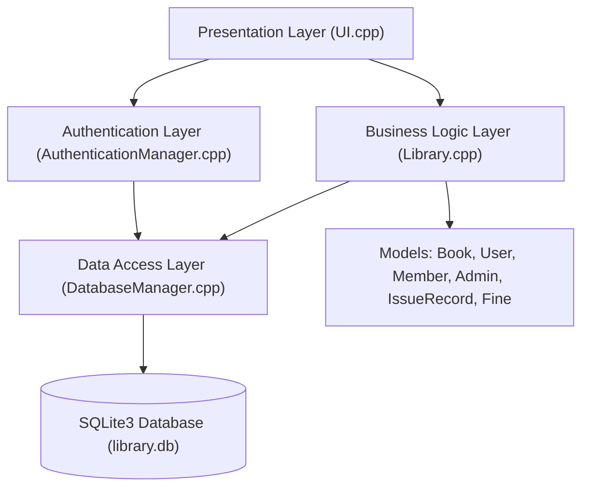
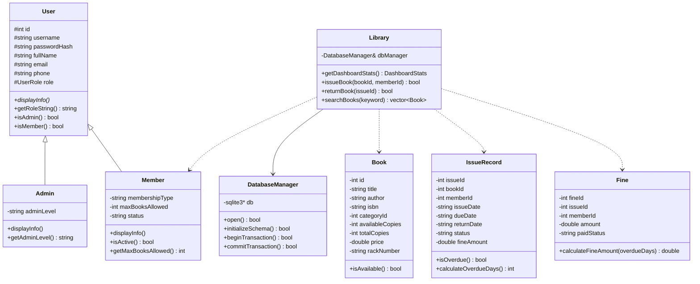
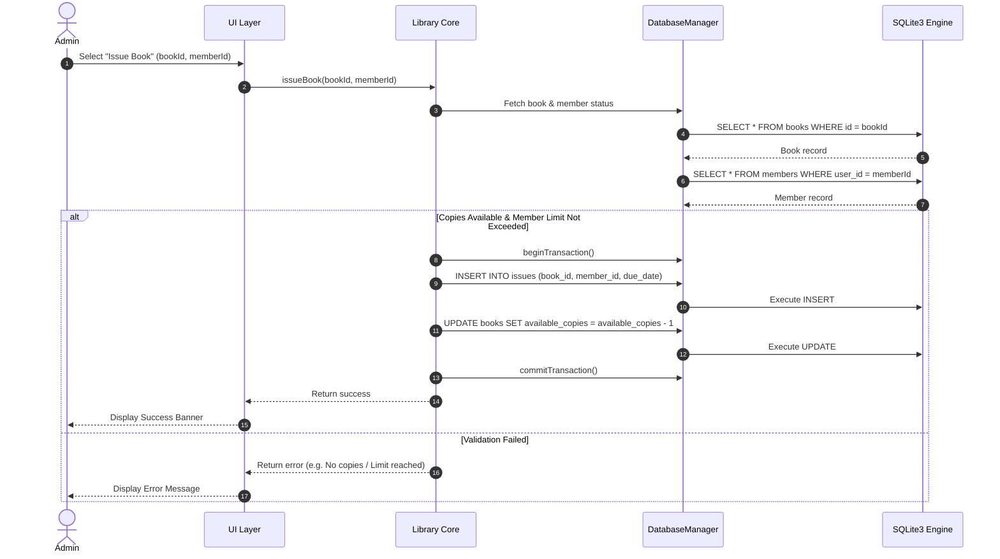

# 🏗️ System Architecture & Design

This document details the high-level architecture, module decomposition, class hierarchy, and data flow of the **Library Management System in C++17**.

---

## 📐 1. Architectural Pattern

The project follows a modified **N-Tier Architecture** (Model-View-Controller / DAO pattern adapted for terminal applications):

### Layer Breakdown
1. **Presentation Layer (`UI.cpp`)**:
   - Interacts with the user via terminal ANSI output.
   - Manages menu loops, user prompts, input sanitization, and table rendering.
   - Delegates all business operations to `Library` and `AuthenticationManager`.

2. **Authentication & Security Layer (`AuthenticationManager.cpp`)**:
   - Manages user login verification and member registration.
   - Uses standard bitwise **SHA-256** for secure password hashing.
   - Instantiates polymorphic `User` pointers (`Admin` / `Member`).

3. **Business Logic Layer (`Library.cpp`)**:
   - Contains core library workflows: issuing, returning, fine computation, overdue updates, catalog filtering.
   - Enforces business rules (e.g. member borrowing limits, suspended status checks, duplicate loan prevention).

4. **Data Access Layer (`DatabaseManager.cpp`)**:
   - RAII wrapper around native `sqlite3*` C pointers.
   - Handles SQL statement execution, parameter binding, transactions (`BEGIN`, `COMMIT`, `ROLLBACK`), and automatic schema creation.

5. **Persistence Storage (`library.db`)**:
   - Relational database storing persistent state across application restarts.

---

## 🧬 2. Object-Oriented Class Hierarchy

---

## 🔄 3. Key Sequence Diagrams

### Book Issue Sequence

---

## 🛡️ 4. Safety & Robustness Features

1. **RAII (Resource Acquisition Is Initialization)**:
   - All SQLite connections and statements (`sqlite3_stmt*`) are bound to stack lifetimes or wrapped in RAII helper functions to prevent memory leaks and dangling resource handles.

2. **SQL Injection Protection**:
   - Raw user input is **never** concatenated directly into SQL queries.
   - All dynamic parameters use parameterized queries with `sqlite3_bind_text`, `sqlite3_bind_int`, and `sqlite3_bind_double`.

3. **Input Validation**:
   - `Utils::readInt` and `Utils::readDouble` catch parsing exceptions (`std::invalid_argument`, `std::out_of_range`) and handle bounds checking safely without crashing terminal stream buffers.

4. **Transaction Integrity**:
   - Multi-table operations (such as returning a book and updating stock/creating fines) are wrapped in `BEGIN TRANSACTION` and `COMMIT`. If any step fails, `ROLLBACK` is executed immediately.
