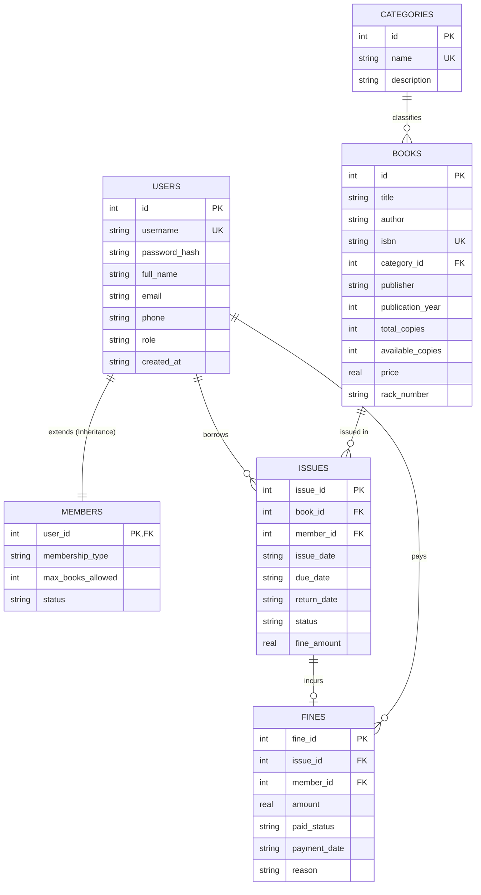

# 🗄️ Database Design & Schema Specification

The **Library Management System** uses an **SQLite3** relational database engine (`database/library.db`). SQLite provides zero-configuration, transactional persistence with lightweight overhead.

---

## 📊 1. Entity-Relationship (ER) Diagram



---

## 📋 2. Relational Schema Data Dictionary

### Table 1: `categories`
Stores literature domain categories.
| Field | Type | Constraints | Description |
| :--- | :--- | :--- | :--- |
| `id` | INTEGER | PRIMARY KEY AUTOINCREMENT | Category unique ID |
| `name` | TEXT | UNIQUE, NOT NULL | Category name (e.g. 'Computer Science') |
| `description` | TEXT | NULLABLE | Description of domain category |

---

### Table 2: `users`
Base entity for authentication storing core profile fields for both Admins and Members.
| Field | Type | Constraints | Description |
| :--- | :--- | :--- | :--- |
| `id` | INTEGER | PRIMARY KEY AUTOINCREMENT | User unique ID |
| `username` | TEXT | UNIQUE, NOT NULL | Account login username |
| `password_hash`| TEXT | NOT NULL | Bitwise SHA-256 password hash |
| `full_name` | TEXT | NOT NULL | Full display name |
| `email` | TEXT | NOT NULL | Contact email address |
| `phone` | TEXT | NOT NULL | Contact phone number |
| `role` | TEXT | CHECK(role IN ('ADMIN', 'MEMBER')) | Role designation |
| `created_at` | TEXT | DEFAULT (date('now')) | Registration timestamp |

---

### Table 3: `members`
Extends `users` table for Member-role specific attributes (Class table inheritance pattern).
| Field | Type | Constraints | Description |
| :--- | :--- | :--- | :--- |
| `user_id` | INTEGER | PRIMARY KEY, FK -> users(id) ON DELETE CASCADE | Foreign key referencing user |
| `membership_type`| TEXT | DEFAULT 'REGULAR' | Tier: REGULAR, PREMIUM, FACULTY |
| `max_books_allowed`| INTEGER| DEFAULT 5 | Borrowing limit cap |
| `status` | TEXT | CHECK(status IN ('ACTIVE', 'SUSPENDED')) | Account operational status |

---

### Table 4: `books`
Stores physical book catalog inventory and shelf positions.
| Field | Type | Constraints | Description |
| :--- | :--- | :--- | :--- |
| `id` | INTEGER | PRIMARY KEY AUTOINCREMENT | Book inventory ID |
| `title` | TEXT | NOT NULL | Book title |
| `author` | TEXT | NOT NULL | Author name(s) |
| `isbn` | TEXT | UNIQUE, NOT NULL | International Standard Book Number |
| `category_id` | INTEGER | FK -> categories(id) ON DELETE SET NULL | Category classification |
| `publisher` | TEXT | DEFAULT 'Unknown Publisher' | Publishing house |
| `publication_year`| INTEGER| DEFAULT 2023 | Release year |
| `total_copies` | INTEGER | DEFAULT 1 | Total owned copies |
| `available_copies`| INTEGER| DEFAULT 1 | Unborrowed copies currently on shelf |
| `price` | REAL | DEFAULT 0.0 | Replacement value |
| `rack_number` | TEXT | DEFAULT 'A1' | Shelf rack code |

---

### Table 5: `issues`
Tracks book borrowing transactions, due dates, and return status.
| Field | Type | Constraints | Description |
| :--- | :--- | :--- | :--- |
| `issue_id` | INTEGER | PRIMARY KEY AUTOINCREMENT | Issue transaction ID |
| `book_id` | INTEGER | FK -> books(id) ON DELETE CASCADE | Foreign key referencing book |
| `member_id` | INTEGER | FK -> users(id) ON DELETE CASCADE | Foreign key referencing borrowing member |
| `issue_date` | TEXT | DEFAULT (date('now')) | Checkout date |
| `due_date` | TEXT | NOT NULL | Date book must be returned |
| `return_date` | TEXT | NULLABLE | Actual date returned |
| `status` | TEXT | CHECK(status IN ('ISSUED', 'RETURNED', 'OVERDUE')) | Transaction state |
| `fine_amount` | REAL | DEFAULT 0.0 | Calculated fine for late return |

---

### Table 6: `fines`
Manages monetary penalties generated from late book returns.
| Field | Type | Constraints | Description |
| :--- | :--- | :--- | :--- |
| `fine_id` | INTEGER | PRIMARY KEY AUTOINCREMENT | Fine record ID |
| `issue_id` | INTEGER | FK -> issues(issue_id) ON DELETE CASCADE | Associated issue transaction |
| `member_id` | INTEGER | FK -> users(id) ON DELETE CASCADE | Target member owing fine |
| `amount` | REAL | NOT NULL | Penalty amount ($) |
| `paid_status` | TEXT | CHECK(paid_status IN ('PENDING', 'PAID')) | Payment state |
| `payment_date` | TEXT | NULLABLE | Timestamp when paid |
| `reason` | TEXT | DEFAULT 'Overdue Book Return' | Reason description |

---

## ⚡ 3. Indexes & Optimization

To ensure fast search queries and efficient joins, the following indexes are declared in `schema.sql`:

```sql
CREATE INDEX IF NOT EXISTS idx_books_title ON books(title);
CREATE INDEX IF NOT EXISTS idx_books_author ON books(author);
CREATE INDEX IF NOT EXISTS idx_books_isbn ON books(isbn);
CREATE INDEX IF NOT EXISTS idx_issues_member ON issues(member_id);
CREATE INDEX IF NOT EXISTS idx_issues_book ON issues(book_id);
CREATE INDEX IF NOT EXISTS idx_issues_status ON issues(status);
CREATE INDEX IF NOT EXISTS idx_fines_member ON fines(member_id);
```
